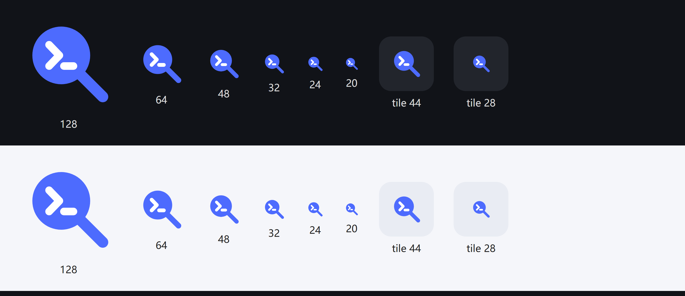

# Codex Lens

**A DeepSeek Harness plugin that turns DSH into a sidecar for your Codex threads.**

在 DSH 右侧栏浏览 `~/.codex` 里的项目与线程，把一条 Codex 线程绑定到当前 DSH 会话；随后在主对话里追问它正在做什么、读它的历史、让它解释代码，或基于这条线程产出汇报 / PPT / 代码走读。



> 显示名 **Codex Lens / Codex 透镜**；插件 id 为 `dsh-codex-bridge`，包名 `dsh-codex-lens`。

## 为什么

Codex 跑一条长任务时，进度、命令、改动和失败轮次都散落在它自己的界面与本地记录里。切回 Codex 只能"看"，不能"问"，也不方便让另一个模型基于完整上下文做二次加工。

Codex Lens 用只读方式把 Codex 的线程"透视"到 DSH：

- 在 DSH 里挑一条 Codex 线程，而不是把转录复制粘贴进对话；
- Codex 还在跑时，直接在 DSH 主对话里问"它现在在做什么、卡在哪一步"；
- 需要产出时，让 DSH 读这条线程的轮次、命令与改动，做代码走读、汇报或 PPT。

## 功能

### 线程浏览器

- 按 Codex 项目分组（`state_<n>.sqlite` 的 `projects` / `project_roots`），无项目的线程按 cwd 归组。
- 默认只显示最近 7 天，勾选"显示全部"后展开更早的线程；每组内再折叠"更早 (n)"。
- 按标题、路径搜索；状态点区分 running / completed / failed / interrupted。
- 侧边对话与子代理单独标记：`attached_thread_parent_id` → 侧边（缩进 + 竖线 + "侧边"徽标，悬停显示父线程）；`thread_source=subagent|guardian_review` → 子代理。支持"隐藏侧边/子代理"只看主对话。

### 绑定与四个只读工具

点击线程即把 `DSH sessionId → Codex threadId` 写入本地绑定表，当前会话随即获得四个工具：

| 工具 | 用途 |
| --- | --- |
| `codex_status` | Codex 是否在工作、最新一轮、最后一条消息、最近步骤；运行中附带实时活动 |
| `codex_overview` | 按轮次总览（分页），含每轮状态、耗时、首条用户消息与回复摘要 |
| `codex_turn` | 单轮明细：思考摘要、命令（含输出头尾）、改动文件与 diff 统计、网页搜索、MCP 调用等 |
| `codex_search` | 在线程全文里检索片段（文件、符号、报错、路径） |

绑定是只读的；解绑在面板底部。

### 线程详情页

双击线程行即可进入（会同时绑定该线程）；也可以点底部的"线程详情"。页内三个页签：

- **数据概览**：6 个 KPI（轮次、成功率、平均耗时/P95、改动文件、累计 tokens）、最近 24 轮耗时柱状图（点击选中该轮）、活动构成环图（悬停联动）、轮次状态堆叠条、每轮活动量曲线、工具与操作条形图、改动最多的文件、起始请求。
- **实时活动**：解析 rollout JSONL 尾部，展示最近一轮的 user / assistant / reasoning summary / exec 命令 / 任务开始与结束事件；运行中每 2 秒刷新，空闲时 5 秒。运行中的线程首次打开会自动切到这一页。
- **工作区文件**：以线程 `cwd` 为根的文件树，目录懒加载；点击文件用资源管理器定位，点"打开工作区"打开根目录。

图表全部是手写 SVG / CSS，不引入图表库。

### 运行中提问

绑定线程正在跑时，`codex_status` 会输出 `current activity (live rollout, newest last)` 段。主对话里直接问：

> Codex 现在在做什么？卡在哪一步？

需要细节时再用 `codex_overview` / `codex_turn` / `codex_search`。

## 安装

### 前置

- DeepSeek Harness `0.2.x`（开发与验证于 `0.2.2-rc.1`）
- 本机存在 Codex 数据目录 `~/.codex`（Codex 桌面端或 CLI 产生）
- 文件定位依赖 Windows 资源管理器；其他平台可浏览文件树，但"在资源管理器中显示"不可用

### 用 DSH CLI 安装（源码）

```bash
dsh plugin --profile desktop add github:moonrzz/dsh-codex-lens
```

把 `desktop` 换成你实际使用的 profile 名。

npm 包发布后可直接用：

```bash
dsh plugin --profile desktop add dsh-codex-lens
```

### 从源码安装

```bash
git clone https://github.com/moonrzz/dsh-codex-lens.git
```

在 DSH 会话里让 agent 执行本地 bundle 安装（把路径换成你的克隆目录）：

```
plugin_manager install_bundle target=<absolute-path-to>/dsh-codex-lens
```

也可以在 DSH 的插件管理界面选择"安装本地 bundle"。

安装结果若为 `application: "restart-required"`（运行中的组合检测到包解析目录变化），完全退出 DSH 后重新打开。

## 使用

1. 打开任意 DSH 会话，右栏选择 **Codex Lens**（或从右栏引导页进入）。
2. 找到目标线程：
   - 单击 → 绑定到当前 DSH 会话；
   - 双击 → 绑定该线程并打开线程详情页（单击绑定有 240 ms 延迟，避免吞掉双击）。
3. 回主对话直接提问，例如：
   - "Codex 现在在做什么？"
   - "把这条线程最近三轮的工作整理成一份周报。"
   - "解释一下它在 `lib/foo.py` 里为什么这么改。"
4. 解绑：面板底部"解绑"。

## 数据来源（只读）

| 来源 | 用途 |
| --- | --- |
| `~/.codex/state_<n>.sqlite` | `threads` / `projects` / `project_roots`：线程列表、标题、cwd、项目、侧边/子代理标记 |
| `~/.codex/thread_history_<n>.sqlite` | `thread_turns` / `thread_items`：轮次状态、耗时、完整条目（思考、命令、diff 统计、工具调用） |
| `~/.codex/sessions/**/rollout-*.jsonl` | 只读尾部 512KB：实时活动与 running 判定 |

Codex Lens 不写 `~/.codex`，不依赖 Codex CLI 或 app-server，不嵌入 Codex UI。

## 绑定存储

`~/.dsh/dsh-codex-bridge/bindings.json`（可用环境变量 `DSH_CODEX_BRIDGE_DIR` 改目录）：

```json
{
  "version": 1,
  "sessions": {
    "<dsh-session-id>": { "threadId": "<codex-thread-id>", "boundAt": "2026-11-09T02:00:00.000Z" }
  }
}
```

## 隐私与安全

- **只读**：不修改 Codex 数据库、rollout、工作区文件；不写会话日志。
- **无网络**：Host 与 Client 不向任何外部服务发请求；所有数据留在本机。
- **路径受限**：文件树与"在资源管理器中显示"只接受线程 `cwd` 内的路径，`..` 与跨盘直接拒绝（`outside-root`）。
- **转录即证据**：注入模型的线程内容来自 Codex，可能包含看起来像指令的文本；系统提示要求模型只引用与分析，不执行。
- **按会话绑定**：绑定只对写入的那个 DSH 会话生效，可通过"解绑"随时移除。

## 工作原理

```
~/.codex  (SQLite + rollout JSONL)
      │  read-only (node:sqlite / fs)
      ▼
Host  lib/codex.js  线程、轮次、统计        lib/live.js  实时活动
      lib/fsbrowse.js 文件树 / reveal      lib/bindings.js 绑定表
      │
      ├─ tools: codex_status / overview / turn / search
      ├─ systemPrompt 段：告知模型可读取的线程与用法
      └─ HTTP: /api/dsh-codex-bridge/{roster,binding,bind,unbind,status,stats,live,tree,reveal}
      ▼
Client  右侧栏 tab：线程树 / 详情页（概览图表、实时活动、文件树）
      ▼
DSH 主对话
```

宿主路由走 DSH 的 `connection.fetch.register`，响应统一为 `{ ok: true, value }` / `{ ok: false, error: { code, message } }`。

## 结构

```
index.js          Host 入口：绑定表、路由、工具、systemPrompt 段、绑定时注入卡片
lib/codex.js      只读 Codex 数据层（SQLite 聚合 + rollout）
lib/live.js       rollout 尾部解析：实时条目 + running 判定
lib/fsbrowse.js   工作区文件树与资源管理器跳转（限制在线程 cwd 内）
lib/render.js     面向模型的文本渲染与字符预算
lib/tools.js      四个工具
lib/routes.js     右侧栏 HTTP 路由
lib/bindings.js   DSH sessionId → Codex threadId
client.js         右侧栏 tab（列表、详情、图表、5s/2s 轮询）
locale/           zh / en 文案
cordis.patch.yml  bundle 安装补丁
```

## 开发

```bash
node --check index.js
node --check client.js
node --check lib/codex.js lib/live.js lib/fsbrowse.js lib/render.js lib/routes.js lib/tools.js lib/bindings.js
```

本地目录安装是 link：改 Host 代码后重启 DSH（或关闭/开启插件）生效；Client 改动刷新页面生效。

隔离测试：新起一个 `DSH_HOME` 验证时，务必给该实例设置 `DSH_CODEX_BRIDGE_DIR`（如 `<测试目录>/bindings`）。绑定表默认存放在 `~/.dsh/dsh-codex-bridge/bindings.json`，是跨 profile 共用的；不隔离会让测试实例覆盖真实 profile 的绑定。

## 兼容性与限制

- 只覆盖本机 `~/.codex` 中仍有 `thread_history` 记录的线程；rollout 被清理的线程仍可看历史，但没有实时尾部。
- 实时流是"尾部重读"（512KB，按条目 id 去重），不是增量订阅；不会连接 Codex app-server。
- 详情页在同一个右栏 tab 内切换（列表 ↔ 详情），不新开 tab。
- 资源管理器定位目前仅 Windows。
- 尚未做 JSONL 全量解析：命令与 diff 以结构化条目为准，`exec` 的 JS 只抽取 ``cmd:`...` ``。

## License

[MIT](LICENSE) © 2026 moonrzz
